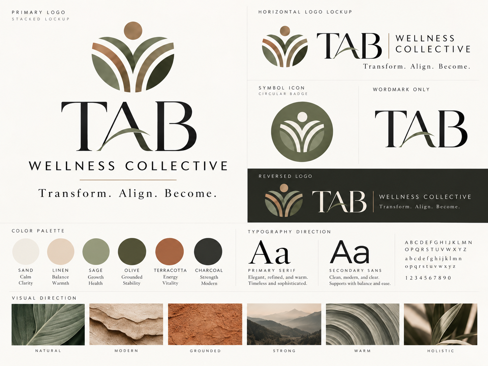
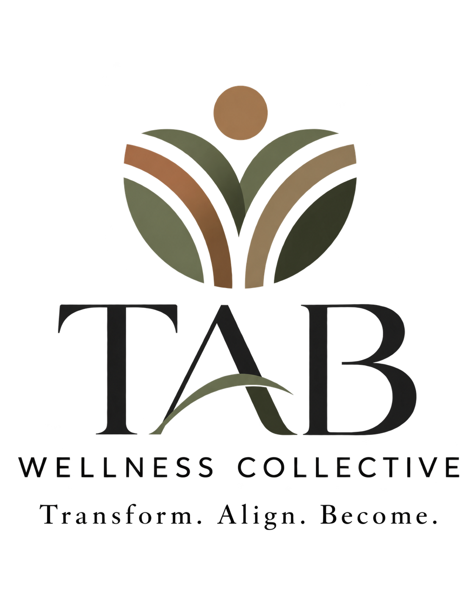
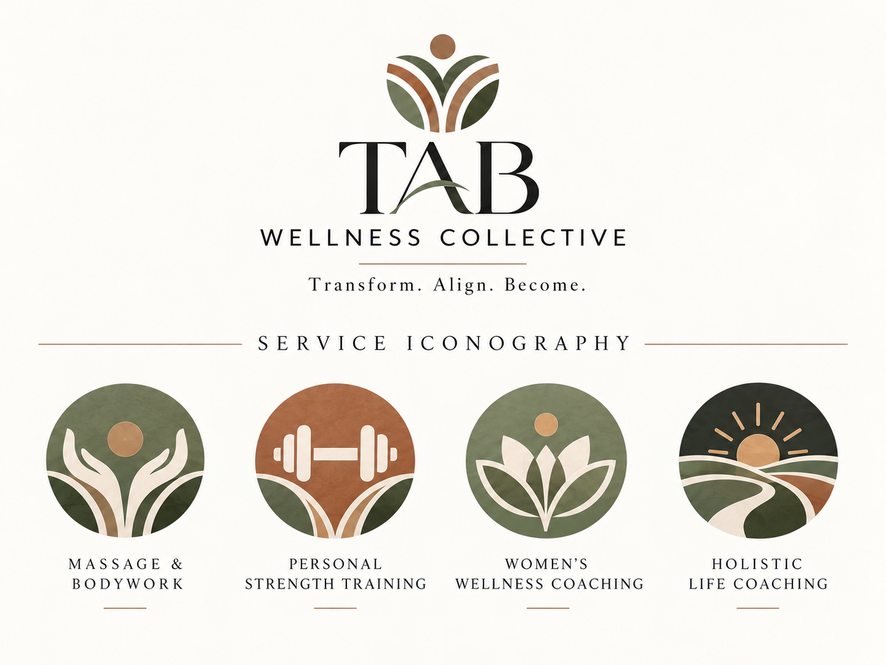
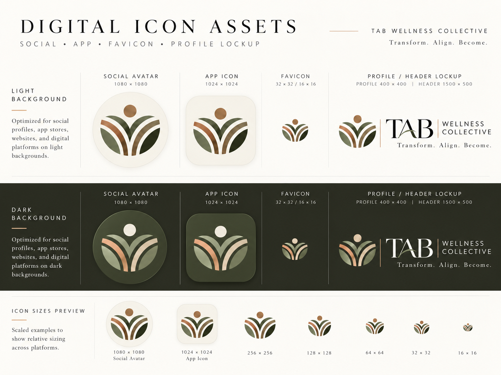

TAB WELLNESS COLLECTIVE

Step 18 — Visual Identity

*Hybrid identity direction using the rooted-growth symbol from Concept 2 and the refined TAB wordmark from Concept 3*

<table>
<colgroup>
<col style="width: 100%" />
</colgroup>
<thead>
<tr>
<th>
Approved direction

TAB Wellness Collective will use a hybrid identity system: the grounded, balanced symbol from Concept 2 paired with the refined TAB wordmark from Concept 3. The approved color palette, typography direction and visual mood are also locked.
</th>
</tr>
</thead>
<tbody>
</tbody>
</table>

Primary board showing the locked visual direction, logo family, palette, typography and mood.

> Grounded. Modern. Refined. Warm. Holistic. Strong. Approachable.

# Executive Summary

Step 18 converts the brand strategy into a usable visual system for TAB Wellness Collective. It defines the approved identity direction, the logo family, color and type systems, iconography, imagery mood, and core usage guidance so that the brand can be applied consistently across the website, My TAB portal, signage, social media, print and operational materials.

## What is locked

- Primary identity direction: Concept 2 symbol + Concept 3 TAB wordmark.

- Primary tagline: Whole-person wellness for stronger bodies and fuller lives.

- Philosophy line: Transform. Align. Become.

- Core color system: Sand, Linen, Sage, Olive, Terracotta and Charcoal.

- Typography direction: a refined serif for brand expression and a clean sans-serif for clarity and usability.

- Visual mood: Natural / Modern / Grounded / Strong / Warm / Holistic.

- Service architecture icons for Massage & Bodywork, Personal Strength Training, Women’s Wellness Coaching and Holistic Life Coaching.

<table>
<colgroup>
<col style="width: 100%" />
</colgroup>
<thead>
<tr>
<th>
Purpose of the visual system

The visual identity should make TAB feel calm, elevated and trustworthy while still remaining warm, grounded and human. It needs to hold together across both lifestyle-facing brand surfaces and more structured operational tools such as the website, My TAB, forms and client materials.
</th>
</tr>
</thead>
<tbody>
</tbody>
</table>

# 18.1 — Approved Identity Direction

The chosen identity is a hybrid of two earlier concepts because each contributed a different strength:

- Concept 2 provided the strongest symbolic expression — a rooted, balanced emblem that evokes growth, alignment, movement, wholeness and a person-centered wellness journey.

- Concept 3 provided the strongest wordmark — a refined TAB treatment that feels timeless, premium, legible and modern without becoming cold.

- The hybrid creates a system that is more ownable and flexible than either concept alone.

| **Component** | **Locked direction** | **Role in the brand** |
|----|----|----|
| Symbol | Rooted-growth symbol from Concept 2 | Primary emblem and icon system; communicates growth, balance and whole-person wellness. |
| Wordmark | TAB wordmark from Concept 3 | Primary brand signature; gives the system elegance, clarity and recognition. |
| Descriptor | WELLNESS COLLECTIVE | Clarifies the full business name and collective model. |
| Philosophy line | Transform. Align. Become. | Connects the identity to the TAB method and larger brand architecture. |

> The symbol expresses the philosophy. The wordmark expresses the brand.

# 18.2 — Logo System

The logo family should be treated as a system rather than a single file. Different placements require different lockups, but all versions should remain visually consistent and be used intentionally.

Primary stacked logo.

## Recommended logo family

- Primary stacked logo — the main signature for centered layouts, brand boards, title pages, signage and select print applications.

- Horizontal logo lockup — the workhorse signature for website headers, portal headers, social cover images, email signatures and most business materials.

- Wordmark only — an elegant premium expression when the brand is already known or where a cleaner minimal treatment is preferred.

- Symbol icon / circular badge — the main icon asset for favicons, social avatars, app buttons, stamps and accent applications.

- Reversed / dark-background logo — a protected alternate for dark fields, overlays and richer atmospheric brand applications.

<table>
<colgroup>
<col style="width: 100%" />
</colgroup>
<thead>
<tr>
<th>
Logo rule

Use the full TAB Wellness Collective lockup for first impression or formal brand-identification moments. Use TAB or the symbol-only mark only after the full brand has been established or where space constraints justify a reduced mark.
</th>
</tr>
</thead>
<tbody>
</tbody>
</table>

# 18.3 — Symbol Icon

The rooted-growth symbol is the heart of the visual identity. It reads simultaneously as leaves, paths, upward movement and a person-centered form. That multivalence is desirable because it mirrors the holistic nature of the brand.

Primary symbol asset.

## What the symbol communicates

- Growth — visible upward motion and unfolding form.

- Alignment — balanced symmetry and centered structure.

- Whole-person wellness — human-centered silhouette with supporting arcs/leaves.

- Journey and support — the curved bands suggest pathways, guidance and progression.

- Warmth and vitality — the terracotta/golden top element adds life and energy to the more grounded green structure.

# 18.4 — Color System

The approved palette balances calm neutrals, grounded greens and a warm terracotta accent. Together they express clarity, stability, growth and warmth while avoiding both sterile clinical palettes and overly trendy wellness palettes.

| **Color** | **Brand role** | **Meaning / feeling** |
|----|----|----|
| Sand | Primary light neutral | Calm, clarity, breathing room, softness. |
| Linen | Secondary warm neutral | Balance, warmth, approachability, natural texture. |
| Sage | Support green | Growth, health, ease, restoration. |
| Olive | Primary grounding green | Grounded stability, depth, trust, sophistication. |
| Terracotta | Accent / energy color | Warmth, vitality, movement, life, human energy. |
| Charcoal | Primary dark neutral | Strength, contrast, modernity and legibility. |

## Practical usage guidance

- Use Sand and Linen as the main field/background colors across web, print and presentation applications.

- Use Charcoal for primary text and high-contrast wordmark applications.

- Use Olive as the main brand support color in panels, separators, icon fields and premium tonal applications.

- Use Sage as a lighter wellness-supporting green or to soften layouts with a more restorative tone.

- Use Terracotta intentionally as an accent — never everywhere. It should add life and warmth without overpowering the system.

# 18.5 — Typography Direction

The typography system should pair an elegant serif with a modern sans-serif. This preserves the brand’s refined, warm and personal qualities while ensuring usability and clarity in digital and operational contexts.

| **Tier** | **Purpose** | **Direction** |
|----|----|----|
| Primary serif | Brand headlines, selected quotes, logo-adjacent expressions, elevated print pieces. | Elegant, refined, warm, timeless. |
| Secondary sans-serif | Body copy, navigation, UI labels, tables, captions, forms, portal text. | Clean, modern, clear and highly usable. |
| Letterspaced caps | Subheads, navigation labels, section markers, micro-brand moments. | Structured, premium and orderly when used sparingly. |

## Type system rule

- Let the serif carry brand expression and emotional tone.

- Let the sans-serif carry utility, readability and interface clarity.

- Use generous spacing, clean margins and moderate line lengths to reinforce calm sophistication.

# 18.6 — Visual Direction & Imagery

The imagery system should feel natural, modern, grounded, strong, warm and holistic. It should not look like generic stock wellness imagery and it should not drift into overly spiritual or overly clinical aesthetics.

## Approved visual mood

- Natural — textures, leaves, stone, landscape, organic curves, light and shadow.

- Modern — clean composition, generous white space and restrained styling.

- Grounded — tactile surfaces, earthy hues and emotionally stable imagery.

- Strong — quiet confidence rather than aggression; capability rather than intensity.

- Warm — human, inviting, never harsh or sterile.

- Holistic — people and environments that suggest integrated wellbeing, not isolated “fitness” or “spa” clichés.

## Photography recommendations

- Prioritize real people, real environments and relational moments over staged stock shots when possible.

- Show people in grounded, everyday wellness contexts: treatment, movement, support, reflection, coaching, and practical routines.

- Avoid hyper-posed fitness imagery, “before/after” transformation tropes, or extremely sterile clinical setups.

- Favor natural light, tonal warmth and subtle texture.

# 18.7 — Service Iconography

The service icon set extends the same visual language into the four service pillars. The icons should function as navigational aids and visual differentiators while still clearly belonging to one brand system.

Service iconography family.

## Service icon roles

| **Service** | **Primary icon idea** | **Intended meaning** |
|----|----|----|
| Massage & Bodywork | Hands / supportive bodywork gesture | Comfort, care, touch, recovery and human support. |
| Personal Strength Training | Barbell / strength symbol | Capability, progressive strength, movement and function. |
| Women’s Wellness Coaching | Floral/lotus-inspired symbol | Support through changing seasons of life, wellbeing and centered growth. |
| Holistic Life Coaching | Path / sunrise landscape | Perspective, clarity, direction, alignment and forward movement. |

<table>
<colgroup>
<col style="width: 100%" />
</colgroup>
<thead>
<tr>
<th>
Service-system rule

Service icons should create light differentiation, not fragmentation. They belong to one shared brand family and should always sit within the broader TAB visual system.
</th>
</tr>
</thead>
<tbody>
</tbody>
</table>

# 18.8 — Digital Icon Assets

The symbol performs especially well in digital environments because it remains recognizable at small sizes and across both light and dark surfaces. The approved digital set includes social avatars, app-style icons, favicons and compact header/profile lockups.

Digital icon and profile asset guidance.

# 18.9 — Core Usage Guidance

## Do

- Use the full-color primary logo on light neutral backgrounds whenever possible.

- Use the reversed version on dark photographic or tonal backgrounds where contrast is protected.

- Maintain generous clear space around the symbol and wordmark.

- Use the symbol-only mark for avatars, favicons, stamps and compact digital surfaces.

- Keep the brand expression calm and uncluttered.

## Do not

- Recolor the logo arbitrarily outside the approved palette.

- Stretch, condense, rotate or rearrange the mark components.

- Add drop shadows, bevels or decorative effects that change the refined character of the system.

- Use too many colors in one layout; the palette should feel restrained and balanced.

- Substitute the shorter phrase “TAB Wellness” as if it were the official public brand.

# 18.10 — Recommended Brand Applications

The visual identity is intentionally flexible enough to support both elevated brand moments and practical operational contexts.

| **Application** | **Recommended treatment** |
|----|----|
| Website header | Horizontal lockup with Start Where You Are as the primary action. |
| Homepage / hero areas | Primary or horizontal logo on light fields with calm, image-led sections. |
| My TAB portal | Symbol + simplified horizontal lockup; stronger UI emphasis on sans-serif utility text. |
| Business cards / print collateral | Primary stacked logo or horizontal logo with restrained palette and ample whitespace. |
| Social profiles | Symbol-only avatar with branded cover/header lockup. |
| Email signatures | Horizontal lockup with Charcoal text and selective Terracotta separators or accents. |
| Signage | Primary stacked or horizontal lockup depending layout; ensure strong contrast and simple backgrounds. |
| Forms / worksheets / plans | Simplified header lockup, sans-serif body content, serif used sparingly for section emphasis. |

# 18.11 — Asset Package Inventory

The following asset files were generated as part of the Step 18 visual package and should be retained as working reference files. A later production phase may still create designer-prepared vector master files (SVG/AI/EPS), export sets and exact font specifications.

| **Working asset file** | **Description** |
|----|----|
| tab_wellness_brand_identity_board.png | Master identity board showing logo family, palette, type direction and visual mood. |
| tab_wellness_collective_logo.png | Primary stacked logo. |
| symmetrical_earthy_growth_emblem.png | Primary symbol / icon asset. |
| tab_wellness_collective_iconography.png | Service iconography board for the four service pillars. |
| tab_wellness_collective_icon_guidelines.png | Digital asset guidance for avatar, app icon, favicon and profile/header lockups. |

# 18.12 — Step 18 Closeout

Step 18 establishes a coherent visual identity system for TAB Wellness Collective. The hybrid logo direction, palette, typography and imagery guidance all support the brand strategy defined in earlier steps: a grounded, empowering, personal, modern and whole-person wellness brand that feels refined and approachable rather than clinical, gimmicky or overly soft.

## What comes next

- Use this visual system as the basis for Step 19 — the rebrand transition plan across website, Timely, Stripe, Google, social and client-facing materials.

- If desired, produce a production-ready design round later with exact vector exports, file naming, clear-space measurements, minimum-size guidance and final font selections.

- Roll these identity assets into a final master TAB Brand & Experience Playbook after Steps 18–19 are complete.

> TAB Wellness Collective — Transform. Align. Become.
